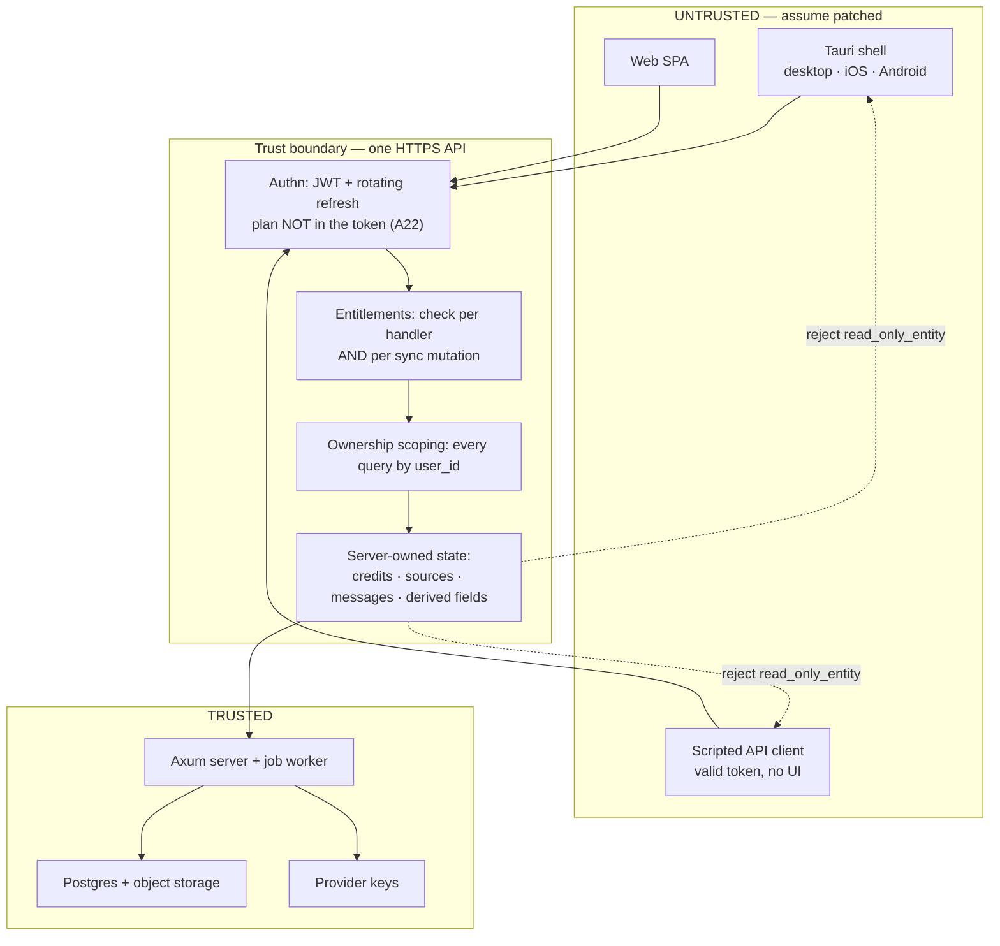

# Threat Model

**Status:** normative. Referenced by A42 (client is untrusted), A43 (free-tier abuse), A44 (licensing).
**Filled by:** Phase 0 (this document), verified by Phase 7 (entitlement bypass grep test) and Phase 8 (cross-tenant isolation test).

This document exists because the product's posture is "the client cannot usefully be modified". That
posture is an architectural property, not a feature, so it needs one place that states the trust
boundary, what is actually enforced, and — importantly — what is **not** enforced and has been
accepted deliberately. Without the last part, a later phase will either assume protection that does
not exist or "fix" an accepted risk by adding client-side checks that provide no security.

---

## 1. Method and assumptions

- **The client is attacker-controlled.** Every client: our signed Tauri build on the user's own
  machine, a patched build, a debugger attached to the webview, or a script speaking directly to the
  API with a valid token. The design must hold for all four, because the API cannot distinguish them.
- **The token is not secret from its owner.** A user holds their own access/refresh tokens and can
  call any endpoint the server exposes. "The UI would never do that" is not a control.
- **The server and its database are trusted.** Postgres, the job worker, and the container are in the
  trusted computing base. An attacker with server access is out of scope.
- **Third parties are semi-trusted.** LLM, embedding, search and payment providers are external
  dependencies whose *responses* are treated as untrusted input (a model can be induced to emit
  markup or a forged citation), but whose transport is assumed authentic.
- **Non-goal: stopping a determined user from reading or editing their own data on their own device.**
  See §6.

---

## 2. Assets

| Asset | Why an attacker wants it | Where it lives |
|---|---|---|
| Provider credentials (LLM, search, payment, APNs/FCM, SMTP) | Free compute, or resale | **Server env only** — never on a device |
| Credit balance and plan entitlement | Free access to paid features | `credit_ledger`, `users.plan_id`, `subscriptions` (server) |
| Other users' data | Privacy harm, plagiarism | Postgres, scoped per `user_id` |
| Google Calendar refresh tokens | Full calendar read/write | Encrypted in `calendar_connections` (server) |
| BYOK keys (Power) | The user's own provider key | Encrypted (`aes-gcm`) in `user_api_keys` (server) |
| Payment integrity | Getting a plan without paying | `payments` + gateway webhook (server) |
| Content (uploaded sources, chunks, embeddings) | IP, or another user's corpus | Object storage + `chunks` (server); **never synced to clients** |
| Service availability / cost ceiling | Denial of service, or financial drain | `provider_cost_ceiling_usd`, rate limits (server) |

---

## 3. Trust boundary

Everything to the left of the boundary is assumed hostile. The only thing the client contributes is
**authenticated intent** ("this user wants to send this message in this workspace"); whether the
intent is permitted, affordable, or well-formed is decided on the right.

---

## 4. Attacker classes

| Class | Capability | Primary defence |
|---|---|---|
| **Casual user** | Edits app state, tries a paid feature | Entitlements per handler (A21/A22) |
| **Curious tinkerer** | Patches the desktop binary, edits the local SQLite cache | Server authority; local edits revert on next pull |
| **Scripted abuser** | Bulk account creation, direct API calls, quota exhaustion | A43 (verification + signup limits + global cap), `provider_cost_ceiling_usd` |
| **Cross-tenant attacker** | Guesses ids, replays cursors, probes endpoints | Per-`user_id` scoping everywhere; `change_log` filtered; Phase 8 isolation test |
| **Malicious document author** | Uploads a PDF/DOCX/SVG containing prompt injection or markup | Retrieved text is data (`<user_context_data>`, A39); citations validated (A17); render escapes and allowlists SVG (A37) |
| **Payment attacker** | Forged/replayed webhook, amount tampering | Signature verification, idempotency, amount equality check (`docs/SPEC.md` § Payments: QRIS via my gateway) |
| **Insider / server compromise** | — | **Out of scope** (trusted base) |

---

## 5. What a modified client can and cannot do

This is the table to consult before adding any check. Each row is a test case in
`crates/server/tests/tamper.rs` (Phase 7).

| Attempt | Outcome | Enforced by |
|---|---|---|
| Unlock a paid feature by editing UI state | **Fails.** Next request → `422 plan_required` / `feature_locked` | Entitlements read from `users.plan_id` + subscription per request (A22, A21) |
| Edit the JWT to add a plan or raise limits | **Fails.** The plan is deliberately not a claim in the token | A22 |
| Grant credits locally, or replay a grant | **Fails.** Balance is `sum(delta)` over `credit_ledger`, written only by the server | A9 |
| Call the LLM / search / Google directly from the app | **Fails.** No provider key exists on any device | `docs/SPEC.md` § PLATFORMS AND ARCHITECTURE |
| Forge an assistant message with fabricated citations | **Fails.** `Message` is rejected with `read_only_entity`; labels are validated against the context the server sent | roadmap § Sync protocol; A17 |
| Mark a source `ready`, or skip ingestion | **Fails.** `Source` is rejected; `status`/`file_key`/`read_only` are server-owned | roadmap § Sync protocol |
| Upload beyond the storage quota | **Fails.** Quota checked server-side before presign | A15, `docs/SPEC.md` § AUTH AND SECURITY |
| Write `flashcards.ease/interval/due` directly | **Fails.** Derived by server-side SM-2 replay; client writes rejected | roadmap § Conflict rules |
| Exceed `web_searches_per_day` / `chat_msgs_per_day` | **Fails.** Counters are `usage_events`, server-side | `docs/SPEC.md` § Entitlements engine |
| Enable checkout on iOS/Android | **Fails.** Server refuses `platform in (ios, android)` | A24 |
| Read another user's rows | **Fails.** Every query scoped by `user_id`; pull is filtered; signed URLs are short-lived and scoped | `docs/SPEC.md` § AUTH AND SECURITY; Phase 8 test |
| Farm free accounts | **Slowed, not eliminated.** Verification + signup limits + per-account cap bound the cost | A43 |
| Fabricate `study_sessions` / `quiz_attempts` / `flashcard_reviews` | **Succeeds.** Accepted — see R1 | — |
| Read or edit the local SQLite cache | **Succeeds.** Accepted — see R2 | — |
| Patch the desktop binary | **Succeeds.** Accepted — see R3 | — |
| Extract and read the SPA bundle | **Succeeds.** Accepted — see R4 | — |

**Reading this table:** the "fails" rows are the product's actual security boundary. The "succeeds"
rows are not bugs; they are the price of shipping a local-first client, and each is bounded to
consequences the attacker inflicts on themselves.

---

## 6. Accepted residual risks

Each is a deliberate decision with a stated revisit trigger. Do not close one without updating this
section and the corresponding assumption row.

**R1 — Fabricated append-only rows.** `flashcard_reviews`, `quiz_attempts` and `study_sessions` accept
client `upsert` by design (they are the offline-write scope, `docs/SPEC.md` § PLATFORMS AND ARCHITECTURE, "Offline scope"). A modified client can
invent rows, inflating its own streaks, dashboard metrics and weak-topic summary, and polluting the
Phase 11 planner's busy-time model.
*Bounded because:* no credit, quota, plan or money depends on these rows. The attacker deceives only
themselves.
*Revisit if:* any feature ever rewards these rows with credits, plan time, or anything of value. Then
the fix is server-side plausibility bounds (a session cannot exceed elapsed wall time; reviews cannot
exceed cards × a plausible rate) — never a client check.

**R2 — Local cache is readable and editable.** SQLCipher is off by default (A13). The cache holds only
the user's own synced entities — never `chunks`, embeddings, or other users' rows
(`docs/SPEC.md` § What is cached locally on native clients). Local edits are overwritten by the next pull.
*Revisit if:* the local cache ever holds more than the user's own synced rows, or a device is ever
shared between accounts.

**R3 — The desktop binary is patchable.** Unavoidable: the user controls the machine. There is no
client-side integrity check that survives a determined attacker, and adding one that *looks* like a
control is worse than none — it invites trusting it.
*Remedy:* the architecture (A42) makes patching pointless, and the EULA (A44) makes it a breach. On
iOS/Android, store code signing provides genuine tamper resistance; treat that as a bonus.

**R4 — Frontend code is extractable.** The SPA ships to the client and can be read. Reading it grants
no capability, because it holds no secret and enforces nothing. Obfuscation is not worth the
maintenance cost.

**R5 — Signup limits can produce false positives.** A43's per-IP limit will throttle a shared campus
NAT or a school lab, which is precisely the target audience.
*Mitigation:* the limit must be generous enough for a classroom, must be configurable, and must have a
manual unblock path for support. Log every block with the IP and count so the false-positive rate is
measurable before it is tuned.

**R6 — Aggregated content can leak through shared caches.** The search result cache (A40) is global
rather than per-user. A query string carries no user data, so a cache hit reveals only that *someone*
asked the same question — not who.
*Revisit if:* the cached key ever incorporates user-scoped data (a workspace filter, a private
document), which would turn a shared cache into a cross-tenant channel.

---

## 7. Tamper resistance by platform

| Platform | Resistance | Mechanism | What it is worth |
|---|---|---|---|
| iOS | Strong | Code signing, App Store review, sandbox, attestation permitted | Real, but not relied upon |
| Android | Moderate | Play signing, Play Integrity available | Real, but not relied upon |
| macOS | Weak | Notarization + hardened runtime; direct download | Slows casual edits only |
| Windows | Weak | Authenticode signature | Slows casual edits only |
| Web | None | User controls the browser | Nothing; server authority only |

The design never depends on this column. It is recorded so that no phase mistakes "signed build" for
"enforcement".

---

## 8. Non-goals

- **DRM.** The user may read, export and delete all of their own data (`Export my data`,
  `Delete account` — `docs/SPEC.md` § AUTH AND SECURITY, "Account deletion"). That is a product promise, not a leak.
- **Client-side anti-cheat or integrity checks as a security control.** See R3.
- **Hiding the API contract.** `docs/API.md` is internal but the contract is discoverable by any
  authenticated client. Security rests on enforcement, not obscurity.
- **Protecting the operator from a compromised server.** Out of scope.
- **Offline enforcement.** Anything offline is advisory; the server re-validates on push
  (`docs/SPEC.md` § PLATFORMS AND ARCHITECTURE, "Offline scope", limits offline writes to six entities precisely so this stays true).

---

## 9. Verification

| Check | Phase | Test |
|---|---|---|
| Every handler goes through entitlements; no bypass | 7 | grep test over `crates/server/src/routes` asserting each handler calls `check` |
| Every row of §5 marked "fails" is actually rejected | 7 | `crates/server/tests/tamper.rs` — one case per row, asserting the exact error code |
| No cross-tenant leakage through `change_log` or pull | 8 | pull for user A never contains user B's `seq` |
| Free-tier abuse controls are live | 7 | unverified account cannot chat/search/ingest; per-IP signup limit trips and logs |
| Provider cost ceiling stops spend | 7 | an account at its ceiling gets a clear error, not a silent spend |
| Webhook forgery/replay/amount tampering rejected | 13 | signature, idempotency, and amount-equality cases (`docs/SPEC.md` § QUALITY BAR, "Payment tests") |
| Retrieved text cannot act as instructions | 12 | injection fixture in an uploaded document does not alter tool behaviour |
| Rendered documents are inert | 6 | a source containing `
<script>` and `<svg onload=…>` produces a PDF with neither |

An unverified claim in this document is a claim the repo does not have. When a phase closes a row of
§5 or §6, it updates this file in the same commit.
