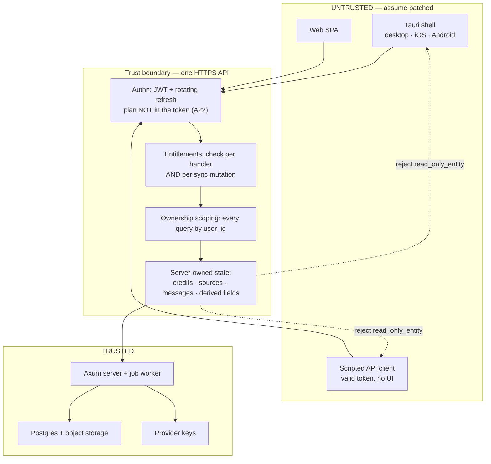

# Threat Model

**Status:** normative. Referenced by A42 (client is untrusted), A43 (free-tier abuse), A44 (licensing).
**Filled by:** Phase 0 (this document), verified by Phase 7 (entitlement bypass grep test) and Phase 8 (cross-tenant isolation test).

This document exists because the product's posture is "the client cannot usefully be modified". That
posture is an architectural property, not a feature, so it needs one place that states the trust
boundary, what is actually enforced, and — importantly — what is **not** enforced and has been
accepted deliberately. Without the last part, a later phase will either assume protection that does
not exist or "fix" an accepted risk by adding client-side checks that provide no security.

---

## 1. Method and assumptions

- **The client is attacker-controlled.** Every client: our signed Tauri build on the user's own
  machine, a patched build, a debugger attached to the webview, or a script speaking directly to the
  API with a valid token. The design must hold for all four, because the API cannot distinguish them.
- **The token is not secret from its owner.** A user holds their own access/refresh tokens and can
  call any endpoint the server exposes. "The UI would never do that" is not a control.
- **The server and its database are trusted.** Postgres, the job worker, and the container are in the
  trusted computing base. An attacker with server access is out of scope.
- **Third parties are semi-trusted.** LLM, embedding, search and payment providers are external
  dependencies whose *responses* are treated as untrusted input (a model can be induced to emit
  markup or a forged citation), but whose transport is assumed authentic.
- **Non-goal: stopping a determined user from reading or editing their own data on their own device.**
  See §6.

---

## 2. Assets

| Asset | Why an attacker wants it | Where it lives |
|---|---|---|
| Provider credentials (LLM, search, payment, APNs/FCM, SMTP) | Free compute, or resale | **Server env only** — never on a device |
| Credit balance and plan entitlement | Free access to paid features | `credit_ledger`, `users.plan_id`, `subscriptions` (server) |
| Other users' data | Privacy harm, plagiarism | Postgres, scoped per `user_id` |
| Google Calendar refresh tokens | Full calendar read/write | Encrypted in `calendar_connections` (server) |
| ICS feed tokens | Read the user's own calendar feed; a **capability URL** | `users.ics_feed_token` (server, **plaintext** — the settings screen must be able to show the link again, A242) |
| BYOK keys (Power) | The user's own provider key | Encrypted (`aes-gcm`) in `user_api_keys` (server) |
| Payment integrity | Getting a plan without paying | `payments` + the gateway's own status route, read by the server (server) |
| Content (uploaded sources, chunks, embeddings) | IP, or another user's corpus | Object storage + `chunks` (server); **never synced to clients** |
| Service availability / cost ceiling | Denial of service, or financial drain | `provider_cost_ceiling_usd`, rate limits (server) |
| **The update channel** (the published `latest.json`, the artifacts it points at, and the minisign key that signs it) | **Every installed desktop copy at once.** An attacker who can serve a manifest the app accepts does not need to compromise a user: the user's own app downloads and runs the attacker's binary, with the user's privileges. This is the highest-value asset in the product, and it did not exist before Phase 15 | `src-tauri/tauri.conf.json` `plugins.updater.pubkey` (compiled into the app); the **private** key is a GitHub Actions secret, never in the repository (A332) |
| **The server image and the print assets it serves** | A forged image is the whole server; a swapped print asset is a document the product prints as if it were its own | Built from this repository by `Dockerfile`; every asset is SHA-256-pinned in `assets/checksums.txt` and verified by `scripts/fetch-print-assets.sh` before it is written (A339) |

---

## 3. Trust boundary

Everything to the left of the boundary is assumed hostile. The only thing the client contributes is
**authenticated intent** ("this user wants to send this message in this workspace"); whether the
intent is permitted, affordable, or well-formed is decided on the right.

---

## 4. Attacker classes

| Class | Capability | Primary defence |
|---|---|---|
| **Casual user** | Edits app state, tries a paid feature | Entitlements per handler (A21/A22) |
| **Curious tinkerer** | Patches the desktop binary, edits the local SQLite cache | Server authority; local edits revert on next pull |
| **Scripted abuser** | Bulk account creation, direct API calls, quota exhaustion | A43 (verification + signup limits + global cap), `provider_cost_ceiling_usd` |
| **Cross-tenant attacker** | Guesses ids, replays cursors, probes endpoints | Per-`user_id` scoping everywhere; `change_log` filtered; Phase 8 isolation test |
| **Malicious document author** | Uploads a PDF/DOCX/SVG containing prompt injection or markup | Retrieved text is data (`<user_context_data>`, A39); citations validated (A17); render escapes and allowlists SVG (A37) |
| **Payment attacker** | Forged/replayed settlement, amount tampering | Idempotency (two defences) and the payable-amount check (`docs/SPEC.md` § Payments: QRIS via my gateway). There is **no callback route to forge**: the gateway never pushes, so the only writer is the server reading the gateway's own status route (A292/A309) |
| **Insider / server compromise** | — | **Out of scope** (trusted base) |

---

## 5. What a modified client can and cannot do

This is the table to consult before adding any check. Every row whose outcome begins
"**Fails.**" is a test case in `crates/server/tests/tamper.rs` (Phase 7), asserted by its
exact error code — and `every_section_5_fails_row_has_a_case` reads this document, so a
"fails" row added here without a case there fails the suite.

| Attempt | Outcome | Enforced by |
|---|---|---|
| Unlock a paid feature by editing UI state | **Fails.** Next request → `403 plan_required` / `feature_locked` | Entitlements read from `users.plan_id` + subscription per request (A22, A21, A143) |
| Edit the JWT to add a plan or raise limits | **Fails.** The plan is deliberately not a claim in the token | A22 |
| Grant credits locally, or replay a grant | **Fails.** Balance is `sum(delta)` over `credit_ledger`, written only by the server | A9 |
| Call the LLM / search / Google directly from the app | **Fails.** No provider key exists on any device | `docs/SPEC.md` § PLATFORMS AND ARCHITECTURE |
| Forge an assistant message with fabricated citations | **Fails.** `Message` is rejected with `read_only_entity`; labels are validated against the context the server sent | roadmap § Sync protocol; A17 |
| Mark a source `ready`, or skip ingestion | **Fails.** `Source` is rejected; `status`/`file_key`/`read_only` are server-owned | roadmap § Sync protocol |
| Upload beyond the storage quota | **Fails.** Quota checked server-side before presign | A15, `docs/SPEC.md` § AUTH AND SECURITY |
| Write `flashcards.ease/interval/due` directly | **Fails.** Derived by server-side SM-2 replay; client writes rejected | roadmap § Conflict rules |
| Exceed `web_searches_per_day` / `chat_msgs_per_day` | **Fails.** Counters are `usage_events`, server-side | `docs/SPEC.md` § Entitlements engine |
| Enable checkout on iOS/Android | **Fails.** Server refuses `platform in (ios, android)` | A24 |
| Read another user's rows | **Fails.** Every query scoped by `user_id`; pull is filtered; signed URLs are short-lived and scoped | `docs/SPEC.md` § AUTH AND SECURITY; Phase 8 test |
| Exceed the provider-cost ceiling | **Fails.** The next spend → `422 limit_reached`, naming the plan whose ceiling is higher; the ledger and `usage_events` are untouched | `credits::spend_in` sums the month's `provider_cost_usd` inside the spend's own transaction, `byok = false` only (A148, A155, A156) |
| Farm signups past the per-IP limit | **Fails.** The next attempt → `429 rate_limited`, logged with the IP, the domain, the count and the rule that tripped | `signup_attempts` is database-backed, so a restart is not a reset (A154, A43) |
| Farm free accounts | **Slowed, not eliminated.** Verification + signup limits + per-account cap bound the cost | A43 |
| Fabricate `study_sessions` / `quiz_attempts` / `flashcard_reviews` | **Succeeds.** Accepted — see R1 | — |
| Read or edit the local SQLite cache | **Succeeds.** Accepted — see R2 | — |
| Patch the desktop binary | **Succeeds.** Accepted — see R3 | — |
| Extract and read the SPA bundle | **Succeeds.** Accepted — see R4 | — |

**Reading this table:** the "fails" rows are the product's actual security boundary. The "succeeds"
rows are not bugs; they are the price of shipping a local-first client, and each is bounded to
consequences the attacker inflicts on themselves.

### The gateway is not reachable from the internet, and there is no callback to forge

**The bridge publishes no port.** `deploy/staging/docker-compose.staging.yml` gives the service no
`ports:` and no `expose:`, so it is reachable only from the compose network by service name, and the
host's own firewall admits only 22 besides. That is the whole of its access control, and it is
stated rather than implied: the bridge is **unauthenticated by design**, because the only client it
has is our own server on the same network (A292). An attacker who reaches it is inside the host
already, and §5's last row puts insider/server compromise out of scope.

**And the one thing that used to be an unauthenticated write path is gone.** Phase 13 shipped
`POST /webhooks/qris` — a route with no bearer token, authorising itself by signature — because B1
was unresolved and every plausible gateway pushed. The gateway that resolved does not: it reports an
outcome only through its own status route. So the route, its three signature schemes, its HMAC key
and its IP allowlist are deleted rather than left dormant, and with them the class of attack they
existed to refuse. A reader looking for the forge/replay/amount-tampering table that used to live
here will find it in git history; the tests that replace it are in §9, and they assert the
properties that still have a subject — idempotency across the client's poll and the sweep, and the
amount check against the payable figure. The one thing this design **cannot** verify is the
gateway's own claim that money arrived, which is R9 in §6.

### The ICS fetch is not a row in the table above

**Reach a private address through an ICS URL → Fails.** Enforced by the shared SSRF guard:
`fetch_guarded_text` reuses `parse_target` + `resolve_public` + the pinned-address client with
a re-check on every redirect hop (A233), and the URL is refused once more at save time with a
400 `validation`. The refusal is asserted against `fetch_guarded_text` **itself** in
`crates/server/tests/ssrf.rs`, alongside ingestion's, because the guard is precisely what
refuses a local stub — a route test that pointed the real fetcher at `127.0.0.1` and passed
would be proving the guard *absent*.

It is deliberately **not** a row of the table, for the same structural reason as the update
channel below: the table answers "what can a *modified client* do", and this attacker has not
modified anything. They control a **document** — an ICS URL the user subscribed to, or a
hostname that resolves differently at fetch time than it did at save time — and the client
they reach is the genuine one. Filing it under client modification would also be actively
harmful, because `every_section_5_fails_row_has_a_case` requires each "**Fails.**" row to have
a case in `crates/server/tests/tamper.rs`, whose subject is the server's HTTP boundary, where
an ICS URL is not a request. The enforcement is real and tested; it lives in `ssrf.rs`.

### The update channel is not a row in the table above

**Forge an update manifest → Fails.** Enforced by the minisign signature verified against the
public key compiled into the app (A332), and exercised on every commit rather than on release
day: `crates/server/tests/release.rs::a_signed_manifest_verifies_and_a_mutated_one_does_not`
signs a fixture manifest with a test keypair and asserts the verifier accepts it, rejects a
one-byte mutation, rejects an absent signature, and rejects a signature from a key that is not
ours.

It is deliberately **not** a row of the table, and that is a structural decision rather than an
oversight: the table answers "what can a *modified client* do", and this attacker has not
modified anything. They control a *response* — a DNS answer, a host, a CDN — and the client they
attack is the genuine, unmodified, correctly signed one. Filing it under client modification
would also be actively harmful here, because `every_section_5_fails_row_has_a_case` reads this
document and requires each "**Fails.**" row to have a case in `crates/server/tests/tamper.rs` —
whose subject is the server's HTTP boundary, where an update manifest is not a request. The
enforcement is real and tested; it just lives in a different suite.

**The trust chain, in the order it can be attacked.** The app is trusted because the OS
verified its code signature; the code signature is trusted because a certificate authority
issued it to the operator; an *update* is trusted because the manifest is signed by a minisign
key whose public half is compiled into the installed app. Every link is either a file in this
repository (the public key, the artifact paths, `scripts/verify-release-artifacts.sh`) or an
operator secret that must never enter it (the private key, the notarization credentials). The
weak link is the last one, and it is R7 below.

**What the client does *not* have to get right, and why that matters.** The manifest's `url` is
not authenticated by the endpoint — the response is not signed — so the signature is what ties
the announced version to the bytes. `tauri-plugin-updater` compares the version in the
signature's *trusted comment* against the version the endpoint announced, and `verify` checks
the global signature that covers that comment before it is read. A manifest whose `url` points
at an older, genuinely signed release therefore fails rather than downgrading the user.

### A hidden instruction in a source cannot make the assistant write (Phase 12)

**Fails.** A retrieved document may make the model *say* anything and still cannot make the app
write a row, because no WRITE tool ever executes without a human confirm (A271): the gate has no
arm that runs one, so a `create_task` becomes a `pending_actions` row plus a confirmation card
and waits. The defence is **structural**, not a promise about the model.

It is not a row of the table above for the same reason the update channel is not, and the reason
is worth stating because it is easy to get wrong: § 5 answers "what can a modified *client* do",
and this attacker modifies nothing — they plant text in a PDF, and the client and the server are
both genuine. Filing it there would also break `every_section_5_fails_row_has_a_case`, which
requires every "**Fails.**" row to have a case in `tamper.rs`, whose subject is the server's HTTP
boundary where a document is not a request.

The test is `crates/server/tests/agent_injection.rs::a_poisoned_source_does_not_create_a_task`,
and it is **two-sided against vacuity** on purpose, because the obvious version of it is
worthless in two independent ways. It asserts (1) against `ScriptedLlm::requests()` that the
poison text **was** in the prompt inside `<sources>`, so the fixture is demonstrably poisoned and
demonstrably delivered; (2) that the scripted model **did** emit the `create_task` call — the call
the gate has to stop, so deleting the gate makes the test fail; and only then (3) that the
database is untouched. A companion assertion covers the other direction: the proposal that *is*
created has `status = 'pending'` and no `tasks` row exists, which distinguishes "the write never
executed" from "the write was refused by a validator" — different defences, both wanted. Without
(1) and (2) the test would still pass with the entire gate deleted, and the threat model would
then cite it.

`crates/core/src/prompts/registry.rs`'s `<security_untrusted_content>` block already carries the
sentence this makes true, and a shipped prompt version is never edited (A38) — so the phase's
work was the test, not the prompt.

---

## 6. Accepted residual risks

Each is a deliberate decision with a stated revisit trigger. Do not close one without updating this
section and the corresponding assumption row.

**R7 — the feed token is a capability URL.** `users.ics_feed_token` is stored in plaintext because the
spec's settings screen requires the link to be shown again at any time (A242), and a hash — the rule for
refresh tokens and login tickets (A53) — cannot be shown again. So a token in a share sheet, a screenshot,
a referrer or a browser preview is a token someone else has, and a database leak hands over every feed.
*Bounded because:* the feed is read-only and carries **only** the user's own app-owned events — never
sources, chunks, chat, or account data (A241) — it is `Cache-Control: no-store` and `X-Robots-Tag: noindex`
so a proxy and a crawler both refuse it, it is revoked and replaced in one click with the old token
asserted dead, and the route logs the resolved `user_id` and the byte length and never the token (A243).
*Revisit if:* the feed ever carries anything beyond the user's own app-owned events.

**R1 — Fabricated append-only rows.** `flashcard_reviews`, `quiz_attempts` and `study_sessions` accept
client `upsert` by design (they are the offline-write scope, `docs/SPEC.md` § PLATFORMS AND ARCHITECTURE, "Offline scope"). A modified client can
invent rows, inflating its own streaks, dashboard metrics and weak-topic summary, and polluting the
Phase 11 planner's busy-time model.
*Bounded because:* no credit, quota, plan or money depends on these rows. The attacker deceives only
themselves.
*Revisit if:* any feature ever rewards these rows with credits, plan time, or anything of value. Then
the fix is server-side plausibility bounds (a session cannot exceed elapsed wall time; reviews cannot
exceed cards × a plausible rate) — never a client check.

**R1 addendum (Phase 9): the session bound this row names now exists, and R1 is still accepted.**

`study_sessions` is one of the six entities a client may write offline, and Phase 9 is the phase that
**displays** it: the Today view's "N min today" is the sum of today's `study_sessions.duration_min`, and
the streak counts consecutive local days that hold a session, a review or an attempt. A fabricated row
is therefore no longer confined to a report nobody opens — it is a number on the home screen, stated as
a fact. That is why the bound arrived here rather than with the dashboard.

The bound is `crates/core/src/study.rs::check_session`, called by `POST /sessions` **and** by
`sync::push::decide`, so a rule cannot hold on one path and not the other:

| Rule | Value |
|---|---|
| `duration_min` | `1 ..= 1440` |
| `started_at` | not more than `MAX_FUTURE_HOURS = 24 h` past `server_now` — the same bound a review and an attempt already use |
| `started_at + duration_min` | not more than `SESSION_CLOCK_GRACE_MIN = 2 min` past the **client's own** `client_ts` |

The third comparison is against the device's own report, not the server's clock, and that is
deliberate rather than a shortcut: a legitimate offline session from a device whose clock runs fast
would be **rejected** by a server-clock comparison, and rejecting valid data is its own defect. The
field is `Mutation.client_ts`, which the sync contract already carried, so no wire change was needed.

*What this changes, and what it does not.* It narrows what a fabricated row can look like — a client
can no longer claim twenty hours of study in an afternoon, and a session cannot claim more time than
the device said had elapsed — and it makes the number on the Today screen consistent with a clock
rather than with the attacker's arithmetic. It does **not** make the rows trusted: a client that lies
coherently (a plausible duration, started inside the elapsed window) still writes a row nobody can
disprove, and every row here remains the account's own claim about itself. The rows are still accepted
by design, the attacker still deceives only themselves, and no credit, quota, plan or money reads them.

*Not built here, and named rather than implied:* the second half of the fix this row names — "reviews
cannot exceed cards × a plausible rate" — is still absent. `flashcard_reviews` and `quiz_attempts`
carry only the future bound a review and an attempt already had. The trigger is unchanged.

*Evidence:* `crates/server/tests/study.rs` (the bound's three rules, each with its boundary),
`crates/server/tests/tamper.rs::a_pushed_session_beyond_its_elapsed_time_is_rejected` (the push path),
`crates/server/tests/offline_tasks.rs::a_session_that_starts_beyond_the_devices_own_clock_is_refused`
(both directions — a session from a clock running 30 h fast is *stored*, so the case tests the bound
and not a check that refuses every session), and `scripts/smoke-phase9.sh` scenario 7.

**R1 addendum (Phase 12): the dashboard reads the same rows, so fabricating them inflates one more
surface the attacker already owns — and no more than that.** `GET /dashboard` counts
`study_sessions`, `flashcard_reviews` and `quiz_attempts` and sums their minutes; `GET /dashboard/topics`
derives accuracy per source from `quiz_attempts`. A fabricated row therefore moves a number on a screen
the student actually looks at, which is the same consequence Phase 9's addendum above records for the
Today view and the streak, one screen further on.

What is *not* widened is the part that matters. The dashboard reports only what traces to a row
(A289): every figure is a count or a sum over the account's own rows, there is no composite score, no
predicted grade and no "retention", so a fabricated row cannot be laundered into a claim the app
computed from something other than the row itself. The rows remain the account's own claim about
itself, and — unchanged from above — no credit, quota, plan or money reads them. The bound is
unaffected too: the dashboard's window is the student's local days, and a session outside the elapsed
bound is refused before it can be counted.

**R2 — Local cache is readable and editable.** SQLCipher is off by default (A13). The cache holds only
the user's own synced entities — never `chunks`, embeddings, or other users' rows
(`docs/SPEC.md` § What is cached locally on native clients). Local edits are overwritten by the next pull.
*Revisit if:* the local cache ever holds more than the user's own synced rows, or a device is ever
shared between accounts.

**R3 — The desktop binary is patchable.** Unavoidable: the user controls the machine. There is no
client-side integrity check that survives a determined attacker, and adding one that *looks* like a
control is worse than none — it invites trusting it.
*Remedy:* the architecture (A42) makes patching pointless, and the EULA (A44) makes it a breach. On
iOS/Android, store code signing provides genuine tamper resistance; treat that as a bonus.

**R4 — Frontend code is extractable.** The SPA ships to the client and can be read. Reading it grants
no capability, because it holds no secret and enforces nothing. Obfuscation is not worth the
maintenance cost.

**R5 — Signup limits can produce false positives.** A43's per-IP limit will throttle a shared campus
NAT or a school lab, which is precisely the target audience.
*Measured:* the limits are **25 signup attempts per IP per rolling 24 h** and **100 per non-public
email domain per 24 h** (`crates/server/src/ratelimit.rs::SIGNUP_PER_IP_PER_DAY` /
`SIGNUP_PER_DOMAIN_PER_DAY`). Every attempt is recorded in `signup_attempts` **before** the `users`
row is written, so a farm's failures count too, and every block is logged at `WARN` with the IP, the
domain, the count, the limit and which rule tripped —
`tracing::warn!(%ip, %domain, count, limit, window = "24h", rule, "signup refused")`
(`crates/server/src/ratelimit.rs`, the only `signup refused` line in the tree). Public mailbox
domains — `gmail.com`, `googlemail.com`, `yahoo.com`/`yahoo.co.id`/`yahoo.co.uk`, `outlook.com`,
`hotmail.com`, `icloud.com`, `proton.me`, `aol.com`, `gmx.com`, `zoho.com`, `yandex.com`, and the
Indonesian providers `telkom.net`, `indosat.net.id`, `xl.co.id`, `cbn.net.id` among others — are
**exempt from the domain rule** (A154): a farm uses gmail too, so a limit there blocks the product's
own growth and stops no farm, while the per-IP rule and the per-account ceiling still bound it.
*Mitigation:* the limit is generous enough for a classroom, is a named constant rather than a magic
number, and the log line is what makes the false-positive rate measurable before it is tuned. The
manual unblock path for support is still owed, and `signup_attempts` rows are pruned after
`SIGNUP_ATTEMPT_RETENTION_HOURS = 48` by the `reset_counters` job.
*Evidence:* `crates/server/tests/abuse.rs::the_per_ip_signup_limit_trips_and_logs` (asserts the 429,
the `rate_limited` code, all four fields of the log line, and that the count lives in the database),
`a_public_email_domain_is_not_rate_limited`, `a_failed_signup_still_records_an_attempt`, and
`a_forwarded_for_header_cannot_buy_a_second_allowance`.
*Revisit if:* the block rate on a campus NAT turns out to be material — the log line is the
measurement, and the numbers above are the ones to retune.

**R6 — Aggregated content can leak through shared caches.** The search result cache (A40) is global
rather than per-user. A query string carries no user data, so a cache hit reveals only that *someone*
asked the same question — not who.
*Revisit if:* the cached key ever incorporates user-scoped data (a workspace filter, a private
document), which would turn a shared cache into a cross-tenant channel.

<!-- R7 is Phase 10's feed-token row, R8 is Phase 15's update key, and R9 is Phase 13's
     gateway row. The numbering follows the phase sequence (R1-R6 are phases 7-9), not
     landing order: these rows were written concurrently and each phase had already
     cross-referenced its own number, so the later-landing slice renumbered. Do not
     renumber one of these back. Phase 13's plan says "R7" for the gateway row because
     that was the next free number when the plan was written; R7 is Phase 10's, so the
     row landed as R9 rather than colliding with it. -->
**R8 — The update key is a single point of trust.** A compromised minisign private key forges an
update that **every installed copy accepts and runs**, with the user's privileges, and the app has
no way to tell it from a genuine one. This is the largest single-point failure in the product: it is
strictly worse than having no updater, because it *looks* like a control, and there is no partial
version of the failure — one key, one release, every install.

**There is no client-side defence, and saying so is the point.** The client is the thing being
replaced, so it cannot be the check. Any mechanism inside the app is executed by the forged binary.
The defence is entirely custody, and it is a **process** rather than a test — the one gate in this
phase that a suite cannot close:

1. The private key and its password are GitHub Actions secrets, and `release.yml` is the **only**
   place they are used (A332).
2. `scripts/verify-release-artifacts.sh` **refuses to run** with `TAURI_SIGNING_PRIVATE_KEY` in its
   environment, because a verification tool that can sign cannot establish the one property it
   exists to establish. That refusal is what keeps the key off a developer's machine by habit
   rather than by discipline.
3. The public key is committed in `src-tauri/tauri.conf.json`, so the trust anchor is reviewable in
   a diff.
4. Rotation requires a **release**, not a config change: installed apps verify against the key
   compiled into them, so a new key reaches an install only through an update signed by the old one.
   If the old key is the thing that was compromised, there is no in-band path — the remedy is
   revoking distribution, a new signing identity, and telling users to reinstall. The procedure and
   the acceptable key storage are in `docs/RELEASE.md`.

*Bounded because:* the attack requires the operator's private key, which is not in the repository,
not in a build artifact, and not on any machine that runs the verifier.
*Revisit if:* the key is ever copied to a developer machine or a second workflow; if a second
person needs to sign a release; or if the operator cannot say where the key is stored. Any of the
three turns a custody problem into an exposure, and the trigger is a conversation rather than a
test failure — which is why it is written here.

---

### R9. The gateway's claim that money arrived is unverifiable by us

**The risk.** Everything this phase does with a payment rests on the gateway telling the truth. If
it reports a payment it never received, or reports one and keeps the money, the server activates a
plan for money that does not exist. Nothing in this tree can tell the difference — and after B1
resolved, the verification that used to sit in front of this is gone entirely: the bridge is polled,
so there is no signed message to verify and no signature strength to argue about. What we have
instead is the gateway's own word, read by us, which is exactly as trustworthy as the counterparty.

**Why it is accepted rather than fixed.** The bridge settles through a GoPay merchant account, so
the money is real and the account is ours — the risk is not a fake gateway but an operator who
misreads a feed, or a GoPay feed that reports a settlement it later reverses. Reconciling against a
bank statement is the real control and it is a manual monthly step, not a code path: there is no
documented settlement API for this account, and building against one whose shape is unknown is the
guess this phase is designed to avoid (A291). The compensations that *are* in place are the ones that
make the risk measurable rather than invisible: every answer we acted on is stored in
`gateway_events` with its raw payload, `payments.provider_status` records what the gateway said, the
hourly reconciliation sweep compares the gateway's own settled transactions against our rows in
**both** directions (money we have no row for, and a payment the gateway has no transaction for),
and both mismatches land as `review` rows with a `review_reason` a human reads. `QRIS_FEE_PERCENT`
defaults to `0`/`0` — "unknown, record nothing" — rather than a plausible-looking rate, so the margin
report says it does not know instead of inventing a number (A304).

**Bounded because:** the exposure is one plan's price per fabricated payment, the gateway is a
single contracted counterparty whose identity the operator controls (A45), and the reconciliation
sweep is what turns a systematic lie into a visible mismatch rate rather than a slow leak.

**Revisit if:** the gateway exposes a settlement API (then reconcile against it and this becomes a
test); or the reconciliation mismatch rate for either direction exceeds **1% of payments in a
month** (then the reconciliation is the product's problem, not the gateway's); or a payment is
disputed and the gateway cannot produce the transaction it reported. The threshold is stated so the
trigger is a number rather than a feeling, and `GET /admin/margin` is where it is read.

---

## 7. Tamper resistance by platform

| Platform | Resistance | Mechanism | What it is worth |
|---|---|---|---|
| iOS | Strong | Code signing, App Store review, sandbox, attestation permitted | Real, but not relied upon |
| Android | Moderate | Play signing, Play Integrity available | Real, but not relied upon |
| macOS | Weak | Notarization + hardened runtime; direct download | Slows casual edits only |
| Windows | Weak | Authenticode signature | Slows casual edits only |
| Web | None | User controls the browser | Nothing; server authority only |

The design never depends on this column. It is recorded so that no phase mistakes "signed build" for
"enforcement".

---

## 8. Non-goals

- **DRM.** The user may read, export and delete all of their own data (`Export my data`,
  `Delete account` — `docs/SPEC.md` § AUTH AND SECURITY, "Account deletion"). That is a product promise, not a leak.
- **Client-side anti-cheat or integrity checks as a security control.** See R3.
- **Hiding the API contract.** `docs/API.md` is internal but the contract is discoverable by any
  authenticated client. Security rests on enforcement, not obscurity.
- **Protecting the operator from a compromised server.** Out of scope.
- **Offline enforcement.** Anything offline is advisory; the server re-validates on push
  (`docs/SPEC.md` § PLATFORMS AND ARCHITECTURE, "Offline scope", limits offline writes to six entities precisely so this stays true).

---

## 9. Verification

| Check | Phase | Test |
|---|---|---|
| The update manifest's signature verifies, and a mutation of it is rejected | 15 | `crates/server/tests/release.rs::a_signed_manifest_verifies_and_a_mutated_one_does_not` — a fixture keypair signs a manifest shaped like the plugin's dynamic response; the case asserts the valid signature verifies, a **one-byte mutation** does not, an absent signature does not, an empty signature does not, and a signature from a **different key** does not. The last of those is the forged-manifest case the phase exists to prevent, and the earlier negatives cannot see it: the bytes are genuine and the signature is well-formed, it is simply not ours. It reproduces `tauri-plugin-updater` 2.13.3's own path (`base64 → utf8 → minisign_verify::PublicKey/Signature::decode → verify(…, allow_legacy = true)`) rather than calling a helper of our own, because a test that verified with a different function would prove something about that function |
| The bundle produces updater artifacts, names a public key, and the permission is desktop-only | 15 | `release.rs::the_bundle_creates_updater_artifacts_and_names_a_public_key` (`createUpdaterArtifacts`, exactly one HTTPS endpoint carrying `{{target}}`/`{{arch}}`/`{{current_version}}`, no `dangerous_insecure_transport_protocol`, a non-blank `pubkey`, `passive` install mode) and `release.rs::the_updater_is_desktop_only` (the permission is in `capabilities/desktop.json` and **not** in `default.json`/`mobile.json`) |
| A published artifact is signed, notarized and stapled before it is released | 15 | `scripts/verify-release-artifacts.sh --macos/--windows/--manifest` — the machine-readable half of the same facts, run by the release job against what it just produced, and refusing to run at all when `TAURI_SIGNING_PRIVATE_KEY` is present (A332, A333, A334) |
| The print assets are served, not fetched, so a sealed container renders math | 15 | `crates/server/tests/assets.rs` (the post-rewrite HTML carries no CDN origin and does contain the base URL for each of the four files) and `crates/server/tests/pdf.rs --ignored`, run **inside the image** by CI's `image` job and by `scripts/release-image.sh` on the host — the PDF's extracted text contains no raw `$`, which is what a missing KaTeX would leave behind (A339, A340) |
| A backup restores, and its data comes back | 15 | `scripts/restore-drill.sh` — restores the newest dump into a scratch database, requires `sqlx migrate info` to report every migration installed and none pending or missing, and compares the sixteen `+sync` tables' row counts against the live database (A347). Run before launch and quarterly after, with its output recorded in `docs/OPERATIONS.md` |
| Every handler goes through entitlements; no bypass | 7 | `crates/server/tests/route_sweep.rs` — `every_registered_route_is_classified` extracts every registered `(method, path)` pair from `crates/server/src` and compares the table **both ways**, and `every_swept_route_refuses_an_exhausted_account` drives each `Swept` row through the real router asserting its exact `(status, code)`. `no_file_outside_the_entitlements_layer_reads_a_plan_limit` greps the tree for a plan-limit read and for the single reader of `provider_cost_ceiling_usd` |
| Every row of §5 marked "fails" is actually rejected | 7 | `crates/server/tests/tamper.rs` — one case per row, asserting the exact error code; `every_section_5_fails_row_has_a_case` reads `docs/THREAT_MODEL.md` and fails when a "fails" row has no case (13 rows today) |
| No cross-tenant leakage through `change_log` or pull | 8 | `crates/server/tests/sync_pull.rs::a_pull_never_contains_another_accounts_seq` (the pull's `seq` set is asserted against each account's own `change_log`), `the_payload_loader_cannot_be_pointed_at_another_users_row` (a planted foreign `entity_id` loads no payload, so the change ships `data: null` rather than another account's row), and `crates/server/tests/sync_convergence.rs::two_accounts_never_cross` — which asserts on the **`seq` values each store ever applied**, not on the absence of a 200, and first asserts both stores applied something so the loop cannot pass by iterating nothing |
| Free-tier abuse controls are live | 7 | `crates/server/tests/abuse.rs` — `an_unverified_account_cannot_reach_its_workspace`, `the_per_ip_signup_limit_trips_and_logs`, `a_public_email_domain_is_not_rate_limited`, `the_spend_cap_trips_at_ten_a_minute_and_never_caps_a_read`, `the_spend_cap_is_per_account`; the gate's full route coverage is `route_sweep.rs` — `every_route_takes_the_extractor_the_table_names` and `an_unverified_account_reaches_only_its_own_surface` (A359) |
| Provider cost ceiling stops spend | 7 | `crates/server/tests/credits.rs::an_account_over_its_provider_cost_ceiling_is_refused` — an account at its ceiling gets `422 limit_reached` naming the plan whose ceiling is higher, with the ledger and `usage_events` untouched; `a_higher_plan_has_a_higher_ceiling` is the other half |
| Webhook forgery/replay/amount tampering rejected | 13 | signature, idempotency, and amount-equality cases (`docs/SPEC.md` § QUALITY BAR, "Payment tests") |
| Retrieved text cannot act as instructions | 12 | `crates/server/tests/agent_injection.rs::a_poisoned_source_does_not_create_a_task` — the phase's real risk, and it is **two-sided against vacuity**: the poison text is asserted to have been in the prompt inside `<sources>` (so the fixture was poisoned *and* delivered), the scripted model is asserted to have emitted the `create_task` call (so deleting the gate fails the test), and only then is the database asserted untouched — with a companion assertion that the proposal which *is* created is `status = 'pending'` and that no `tasks` row exists. § 5's subsection above carries the reasoning for why it is not a § 5 row |
| Rendered documents are inert | 6 | a source containing `
<script>` and `<svg onload=…>` produces a PDF with neither |
| A replayed mutation applies **nothing**, not merely answers the same | 8 | `crates/server/tests/sync_push.rs::a_replayed_mutation_applies_nothing` asserts the row's `updated_at` **and** the account's `change_log` count are both unchanged; `crates/server/tests/sync_convergence.rs::a_replayed_mutation_through_the_outbox_applies_nothing` is the same property through the engine, with the first response lost so the replay is the client's own retry |
| A mutation id belonging to another account never returns that account's result | 8 | `sync_push.rs::a_mutation_id_belonging_to_another_account_is_a_conflict` — `mutation_log.mutation_id` is a **global** primary key, so the collision is representable; the answer is `Rejected{code: "conflict"}` and never the stored result (A172) |
| Another account's row id is not written and not disclosed | 8 | `sync_push.rs::another_accounts_row_is_not_found_and_never_written` — the upsert's conflict clause carries `where <table>.user_id = excluded.user_id`, so the statement affects nothing and the answer is `not_found`, which is deliberately the same answer as "gone" (A173) |
| A body cannot claim another device | 8 | `sync_push.rs::a_body_cannot_claim_another_device` — 403 `forbidden`, because `origin_device_id` is only worth recording if the claim is checkable (A171) |
| The push takes the advisory lock before it touches a row | 8 | `sync_push.rs::the_push_takes_the_advisory_lock_before_it_touches_a_row` holds the lock in another transaction, waits until a push is blocked on it, and asserts the blocked push holds **no** `RowExclusiveLock` on `tasks` — a lock it would hold if it had written a row first. The route's lock order is the roadmap's rule; the test proves the ordering rather than the file |
| Two devices editing overlapping rows both succeed, with no `40P01` | 8 | `sync_push.rs::two_devices_editing_overlapping_rows_both_succeed` (two devices, one account, a two-mutation batch each, concurrently) and `sync_convergence.rs::two_devices_pushing_overlapping_batches_both_succeed` (the same through the engine, in **opposite** orders) |
| A revoked device's token is refused and its cache is wiped | 8 | `crates/server/tests/sync_convergence.rs::a_revoked_device_is_wiped` — the account revokes the device from another device, the next pass returns `Revoked`, and the cached row, the outbox and the cursor are asserted **on the store** (A186) |
| The offline-writable entities really are written offline | 9 | `crates/server/tests/offline_tasks.rs::a_task_an_event_and_a_session_written_offline_sync_after_reconnect` — a task, an event and a session are written through Phase 8's real client engine with a failing transport, the server is read **directly from Postgres and holds zero rows**, and after reconnect it holds all three under the device's own ids. A write that secretly went through REST cannot pass this case, which is why the "nothing on the server" half is asserted rather than assumed |
| A replayed flush writes one row | 9 | `offline_tasks.rs::flushing_the_same_session_id_twice_writes_one_row` — the same append-only id flushed twice with the second response lost leaves the row's `updated_at` and the `change_log` count unchanged, asserted on the row rather than on the push response |
| A session beyond its reported elapsed time is refused on **both** paths | 9 | `crates/server/tests/study.rs::a_session_longer_than_the_client_reported_elapsed_time_is_refused`, `crates/server/tests/tamper.rs::a_pushed_session_beyond_its_elapsed_time_is_rejected` (R1 addendum) |
| A client cannot write the calendar-owned event columns | 9 | `crates/server/tests/events.rs::a_client_cannot_set_the_columns_the_calendar_sync_owns` — each of `source != "app"`, `external_id`, `etag` and `connection_id` separately, a null counting as setting it; `tamper.rs::a_pushed_event_with_a_google_source_is_rejected` is the push half (`read_only_entity`) |
| An externally sourced event cannot be edited or deleted | 9 | `events.rs::an_externally_sourced_event_cannot_be_edited_or_deleted` (403 naming the calendar, under the row lock) and `offline_tasks.rs::a_calendar_owned_event_is_read_only_on_both_paths` (the same through push) |
| A settings mutation for another account is refused, not applied | 9 | `tamper.rs::a_pushed_settings_row_for_another_user_id_is_rejected` — `user_settings`' primary key *is* `user_id`, so a forged mutation id would otherwise be accepted and silently do nothing, which looks exactly like success |
| A reminder channel the plan does not grant is refused per channel | 9 | `crates/server/tests/settings.rs::a_channel_the_plan_does_not_grant_is_refused_with_the_plan_that_does` — through `entitlements::require`, with the row left as it was |
| Both generative actions are refused on a plan that does not grant them | 9 | `crates/server/tests/route_sweep.rs::every_swept_route_refuses_an_exhausted_account` drives `POST /tasks/quick-capture` and `POST /tasks/{id}/breakdown` through the real router asserting 403 `plan_required`, and `crates/server/tests/tasks.rs::quick_capture_is_refused_on_a_plan_that_does_not_grant_it` is the direct half |
| The two generative routes write no row | 9 | `tasks.rs::a_capture_returns_a_draft_and_writes_no_task`, `a_breakdown_returns_a_proposal_and_writes_no_subtasks`, `accepting_a_proposal_creates_ordered_subtasks` — the task count is read before and after, and the accepted subtasks come back in the proposed order |
| Every new route is classified, and no handler reads a plan limit | 9 | `route_sweep.rs::every_registered_route_is_classified` (both directions: an unclassified route **and** a stale row), `no_file_outside_the_entitlements_layer_reads_a_plan_limit` |
| ICS feed cannot be brute-forced or indexed | 10 | `crates/server/tests/calendar.rs` — the feed is `text/calendar`, `no-store` and `noindex`, the route is in the 30/min/IP auth bucket, and a regenerated token 404s the old one while the new one serves |
| A task deleted offline tombstones its subtree, and a restore brings back only what the cascade took | 9 | `offline_tasks.rs::deleting_a_parent_offline_tombstones_its_children`, `restoring_a_parent_restores_only_the_children_its_delete_tombstoned` (A197) |

| The payment path activates once, and only for the amount it asked for | 13 | `crates/server/tests/payment_jobs.rs` — `a_replayed_answer_activates_once` (one activation, one `gateway_events` row), `an_offset_invoice_activates_against_its_payable_amount` (a settlement for the payable activates; one for the bare price is `review` naming both numbers), `the_checkout_poll_asks_the_gateway_and_activates`, and `crates/server/tests/qris_gateway.rs` for the wire itself |

### The payment path's three refusals, with their tests

There is no callback route to forge (the gateway never pushes), so what remains is asserted against
the code that does exist — the two ingresses that read the gateway's own answer, and the one
function that acts on it:

| Attempt | Outcome | Enforced by | Test |
|---|---|---|---|
| Read the same settlement twice to double-activate | **Refused.** One subscription, one credit grant, one `gateway_events` row | `gateway_events`' `unique (provider, event_id)` with `on conflict do nothing returning id`, **and** the guarded transition `update payments … where id = $1 and status = 'pending'` (A293). The synthesised event id `gateway:<provider_payment_id>:<paid_at>` is stable, so two reads of one settlement collide on the unique key exactly as two callbacks would | `payment_jobs.rs::a_replayed_answer_activates_once` |
| Settle for an amount that is not what the invoice asked for | **Refused.** Marked paid-but-`review` with both numbers in `review_reason`, so a human reads it | The check is against `payable_amount_idr` — the figure the QR encodes and the buyer was told to transfer — not the price; both over- and under-payment are the same outcome (A294) | `payment_jobs.rs::an_offset_invoice_activates_against_its_payable_amount` |
| Ask the gateway about another account's payment | **Refused.** The row is not read and the gateway is not asked | `billing::poll::refresh_pending` scopes its statement by `user_id`, like every other query a client can reach | `billing.rs` — the 404 on another account's payment id |

**What nothing proves** is the gateway's own claim that money arrived: with the callback gone there
is no message to verify at all, only a status route we read. That is R9 in §6.

An unverified claim in this document is a claim the repo does not have. When a phase closes a row of
§5 or §6, it updates this file in the same commit.
